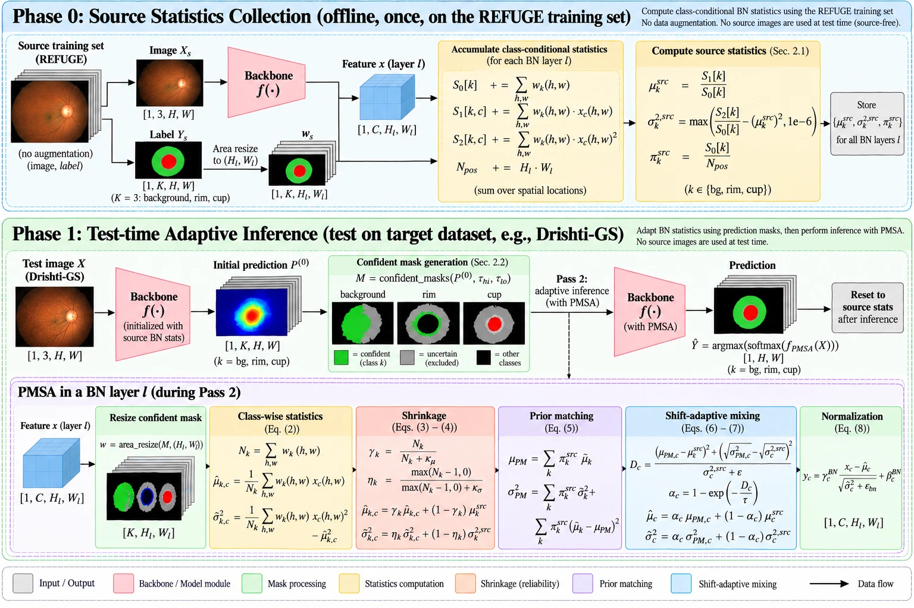
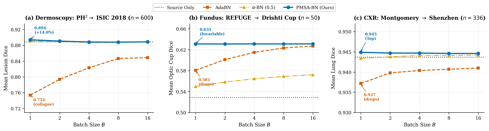

# PMSA-BN: Prior-Matched, Shift-Adaptive Batch Normalization

**Training-free, single-image ($`B=1`$) test-time adaptation for medical image segmentation.**

[](https://www.python.org/downloads/)
[](https://pytorch.org/)
[](LICENSE)

PMSA-BN adapts the batch-normalization (BN) statistics of a trained segmentation network to each incoming test image, one image at a time, without gradients and without target labels. It separates two things that ordinary BN adaptation mixes up: **how a structure looks** (appearance shift, which should be adapted) and **how much of the image it occupies** (label-proportion shift, which should not).

**Key results (17 source→target transfers, 4 imaging modalities, 3 seeds, $`B=1`$):**

- Highest mean score on **all 17 transfers** and every metric, against Source Only, TENT, AdaBN, α-BN, and an **α-BN oracle whose α is tuned on target labels**.
- **Never falls below the source model**, whereas AdaBN does on 13/17 transfers and TENT on 11/17.
- **Same picture with a second backbone** (MobileNetV2), and stable across batch sizes 1–16.
- **About 25 ms per 384×384 image** (two forward passes, no backpropagation), against 284 ms for TENT.



---

## Contents

1. [Why single-image BN adaptation fails](#1-why-single-image-bn-adaptation-fails)
2. [Method](#2-method)
3. [Bayesian shrinkage in depth](#3-bayesian-shrinkage-in-depth)
4. [Why PMSA-BN beats AdaBN, α-BN and TENT](#4-why-pmsa-bn-beats-adabn-α-bn-and-tent)
5. [Results](#5-results)
6. [Ablation, sensitivity and runtime](#6-ablation-sensitivity-and-runtime)
7. [Mathematical derivations](#7-mathematical-derivations)
8. [Repository structure](#8-repository-structure)
9. [Getting started](#9-getting-started)
10. [License](#10-license)

---

## 1. Why single-image BN adaptation fails

A BN layer normalizes each channel with a mean and variance. The lightest test-time adaptation (TTA) methods simply re-estimate these statistics on the test data:

| Method | What it does at test time | Problem at $`B=1`$ |
| :-- | :-- | :-- |
| **AdaBN** | Replaces the stored source statistics with the statistics of the test image. | Mixes appearance shift with label-proportion shift; replaces every channel. |
| **α-BN** | Mixes source and test statistics with one global weight α. | The right α differs per target (0.1 to 0.9 in our data) and cannot be set without labels. |
| **TENT** | Minimizes prediction entropy by gradient steps on the BN affine parameters. | Needs backpropagation (≈11× slower) and is unstable on a single image. |
| **PMSA-BN** | Class-conditional statistics, recombined with source proportions, mixed per channel. | — |

### 1.1 The label-proportion confound

For any BN channel, the statistics pooled over an image decompose over its $`K`$ classes by the law of total variance:

```math
\mu=\sum_{k}\pi_k\,\mu_k,\qquad
\sigma^2=\underbrace{\sum_{k}\pi_k\,\sigma_k^2}_{\text{within-class}}+\underbrace{\sum_{k}\pi_k\,(\mu_k-\mu)^2}_{\text{between-class}}
\qquad\qquad(1)
```

where $`\pi_k`$ is the fraction of positions belonging to class $`k`$ and $`(\mu_k,\sigma_k^2)`$ its class-conditional statistics. AdaBN re-estimates the left-hand side, so it reacts to **two different changes**:

1. a change in $`(\mu_k,\sigma_k^2)`$, i.e. a structure **looks** different (genuine appearance shift), and
2. a change in $`\pi_k`$, i.e. the image simply **contains** more or less of a structure (a larger optic cup, a lesion filling the frame).

The second change is not a domain shift, but AdaBN "corrects" it anyway. In segmentation the background dominates and foreground size varies strongly between patients, so this confound is the rule. With one image per adaptation step ($`B=1`$) it cannot be averaged out.

### 1.2 Indiscriminate replacement

AdaBN overwrites every channel, and α-BN mixes every channel with the same weight, although a shift usually affects only some channels. The best global α of α-BN ranges from **0.1 to 0.9** across our 17 targets, so no single value works everywhere.

---

## 2. Method

PMSA-BN changes only the normalization statistics. The network weights and the BN affine parameters $`(\gamma^{BN},\beta^{BN})`$ are never updated.

### 2.1 Notation

| Symbol | Meaning |
| :-- | :-- |
| $`K`$ | number of classes; they must partition the image (fundus: background, rim = disc − cup, cup) |
| $`\mu^{src}_c,\ \sigma^{2,src}_c`$ | stored BN running statistics of channel $`c`$ |
| $`\mu^{src}_k,\ \sigma^{2,src}_k,\ \pi^{src}_k`$ | source class statistics and class proportions (Phase 0) |
| $`P^{(0)}`$ | class probabilities from pass 1 (source statistics) |
| $`M_k`$ | confident pseudo-mask of class $`k`$ |
| $`w_k(i,j)\in[0,1]`$ | fraction of feature position $`(i,j)`$ covered by class $`k`$ at the current layer |
| $`N_k=\sum_{i,j}w_k(i,j)`$ | effective number of class-$`k`$ positions at the current layer |

### 2.2 Phase 0: source class statistics (offline, once)

After training, the labelled source training images are passed through the network once, without augmentation. At every BN layer the ground-truth masks are resized to the layer resolution, giving class weights $`w_k(i,j)`$ (see [Section 3.1](#step-by-step-how-the-mask-is-brought-to-each-bn-layers-resolution) for exactly how). From these we accumulate the class-conditional mean $`\mu^{src}_k`$, variance $`\sigma^{2,src}_k`$ and proportion $`\pi^{src}_k`$ of every channel. Only these summaries are stored ($`2K`$ numbers per channel and $`K`$ proportions per layer); **no source images are needed at test time**. As a check, $`\sum_k \pi^{src}_k\mu^{src}_k`$ matches the BN running mean up to the small gap caused by training-time augmentation.

### 2.3 Phase 1: adaptation of each test image (two forward passes)

**Pass 1 and confident pseudo-masks.** A forward pass with the source statistics gives $`P^{(0)}`$. Only confident pixels are kept:

```math
M_k=\{(i,j):\ \arg\max_{k'}P^{(0)}_{k'}=k,\ P^{(0)}_k>\tau_{hi}\},\qquad
M_{bg}=\{(i,j):\ P^{(0)}_k<\tau_{lo}\ \ \forall k\neq bg\}
```

with $`\tau_{hi}=0.9`$ and $`\tau_{lo}=0.1`$. All other pixels are uncertain and excluded. For nested structures the disc mask is $`\{P_{rim}+P_{cup}>\tau_{hi}\}`$, the cup mask is restricted to the disc, and the rim is their difference.

**Pass 2: class-conditional statistics.** In the second pass every BN layer, in forward order, average-pools $`M_k`$ to its resolution and computes

```math
\hat\mu_k=\frac{1}{N_k}\sum_{i,j}w_k(i,j)\,x(i,j),\qquad
\hat\sigma_k^2=\frac{1}{N_k}\sum_{i,j}w_k(i,j)\,\big(x(i,j)-\hat\mu_k\big)^2
\qquad\qquad(2)
```

**Pseudo-count shrinkage** (details in [Section 3](#3-bayesian-shrinkage-in-depth)):

```math
\tilde\mu_k=\gamma_k\,\hat\mu_k+(1-\gamma_k)\,\mu^{src}_k,\qquad \gamma_k=\frac{N_k}{N_k+\kappa_\mu}
\qquad\qquad(3)
```

```math
\tilde\sigma_k^2=\eta_k\,\hat\sigma_k^2+(1-\eta_k)\,\sigma^{2,src}_k,\qquad \eta_k=\frac{(N_k-1)_+}{(N_k-1)_++\kappa_\sigma}
\qquad\qquad(4)
```

**Prior matching.** The classes are recombined as in Eq. (1), but with the **source** proportions:

```math
\mu_{PM}=\sum_k\pi^{src}_k\,\tilde\mu_k,\qquad
\sigma^2_{PM}=\sum_k\pi^{src}_k\,\tilde\sigma_k^2+\sum_k\pi^{src}_k\,(\tilde\mu_k-\mu_{PM})^2
\qquad\qquad(5)
```

**Shift-adaptive mixing.** Each channel's shift is measured by the squared 2-Wasserstein distance between $`\mathcal N(\mu_{PM,c},\sigma^2_{PM,c})`$ and $`\mathcal N(\mu^{src}_c,\sigma^{2,src}_c)`$, normalized by the source variance, and mapped to a mixing weight:

```math
D_c=\frac{(\mu_{PM,c}-\mu^{src}_c)^2+(\sigma_{PM,c}-\sigma^{src}_c)^2}{\sigma^{2,src}_c+\epsilon},\qquad
\alpha_c=1-e^{-D_c/\tau}
\qquad\qquad(6)
```

```math
\hat\mu_c=\alpha_c\,\mu_{PM,c}+(1-\alpha_c)\,\mu^{src}_c,\qquad
\hat\sigma^2_c=\alpha_c\,\sigma^2_{PM,c}+(1-\alpha_c)\,\sigma^{2,src}_c
\qquad\qquad(7)
```

```math
y_c=\gamma^{BN}_c\,\frac{x_c-\hat\mu_c}{\sqrt{\hat\sigma^2_c+\epsilon_{BN}}}+\beta^{BN}_c
\qquad\qquad(8)
```

An unshifted channel keeps its source statistics ($`\alpha_c\approx 0`$); a strongly shifted channel adopts the target statistics ($`\alpha_c\to 1`$). One temperature $`\tau`$ controls the transition and is chosen per **source** domain, without target data. The segmentation is the arg max of pass 2, and all statistics are reset before the next image.

### 2.4 Proposition 1 (label-proportion invariance)

> $`(\mu_{PM},\sigma^2_{PM})`$ does not depend on the target proportions $`\pi^{tgt}`$. If, in addition, the class statistics match the source, it equals the pooled source statistics for **any** $`\pi^{tgt}`$, so $`D_c\approx 0`$ and $`\alpha_c\approx 0`$.

*Proof.* Eq. (5) weights the classes by $`\pi^{src}`$ only. Substituting the source class statistics gives Eq. (1) evaluated on the source, i.e. the pooled source statistics, which equal the BN running statistics up to the Phase-0 estimation error. AdaBN instead uses

```math
\mu_{AdaBN}=\sum_k\pi^{tgt}_k\,\mu_k,\qquad
\mu_{AdaBN}-\mu^{src}=\sum_k\big(\pi^{tgt}_k-\pi^{src}_k\big)\,\mu_k\neq 0
```

whenever the proportions change and the class means differ, even though no class changed its appearance. $`\blacksquare`$

### 2.5 Properties

| Property | Why it holds |
| :-- | :-- |
| No shift, no change | $`D_c\approx0\Rightarrow\alpha_c\approx0`$; on held-out source images Dice changed by < 0.002 (mean $`\alpha\approx0.01`$). |
| Label-proportion invariance | Proposition 1. |
| Well defined at $`B=1`$ for any mask size | Shrinkage (Section 3); an empty class falls back to its source statistics. |
| Cheap | Two forward passes, no backpropagation, $`O(KC)`$ extra work per BN layer. |

---

## 3. Bayesian shrinkage in depth

Class-conditional statistics solve the label-proportion confound, but they create a new problem: **at deep layers a small structure covers very few feature positions**, so Eq. (2) is estimated from a handful of numbers. This section shows how quickly the mask shrinks, why that makes raw estimates unreliable, and how Eqs. (3)–(4) fix it. Full derivations are in [Section 7](#7-mathematical-derivations) (D5–D9).

### 3.1 How the mask shrinks through the encoder and grows back in the decoder

#### Step by step: how the mask is brought to each BN layer's resolution

The confident pseudo-mask $`M`$ from pass 1 lives at the **input resolution** (384×384 for fundus). It has one channel per class: $`M_k(u,v)=1`$ if pixel $`(u,v)`$ is a confident pixel of class $`k`$, and $`0`$ otherwise. An uncertain pixel is $`0`$ in **every** channel.

A BN layer, however, normalizes a feature map of a different size, $`H_l\times W_l`$: 192×192 after the first stride-2 convolution, down to 12×12 at the bottleneck, and back up to 384×384 at the end of the decoder. To compute class statistics at that layer we need to know, for every feature position $`(i,j)`$, how much of it belongs to each class. Each PMSA-BN layer obtains this by **adaptive average pooling** of the full-resolution mask, computed inside the layer just before its statistics:

```python
# inside PMSABatchNorm2d.forward(x), x: [B, C, H_l, W_l]
w = F.adaptive_avg_pool2d(M, (H_l, W_l))      # M: [1, K, H, W]  ->  w: [1, K, H_l, W_l]
N = w.sum(dim=(2, 3))                         # effective count of each class at this layer
```

**1. What one pooled value means.** With stride $`S_l=H/H_l`$, feature position $`(i,j)`$ corresponds to an $`S_l\times S_l`$ block of input pixels. Adaptive average pooling replaces that block by its mean:

```math
w^{(l)}_k(i,j)=\frac{1}{S_l^{2}}\sum_{u=0}^{S_l-1}\sum_{v=0}^{S_l-1}M_k\big(iS_l+u,\ jS_l+v\big)\ \in[0,1].
```

So $`w^{(l)}_k(i,j)`$ is simply **the fraction of that block covered by confident class-$`k`$ pixels**: 1 if the block lies entirely inside the structure, 0 if it lies entirely outside, and a value in between if it straddles a boundary. For a 12×12 bottleneck ($`S_l=32`$), each position summarizes a 32×32 block of 1024 input pixels.

**2. Why the total count shrinks by exactly $`S_l^2`$.** Summing over all positions adds up every input pixel exactly once and divides by $`S_l^2`$:

```math
N^{(l)}_k=\sum_{i=1}^{H_l}\sum_{j=1}^{W_l}w^{(l)}_k(i,j)=\frac{1}{S_l^2}\sum_{u,v}M_k(u,v)=\frac{N^{(0)}_k}{S_l^{2}}\ \approx\ \pi_k\,H_l\,W_l .
```

The **fraction** of the image a class covers is preserved; only the **number of positions** carrying it falls, quadratically with the stride.

**3. Encoder (downsampling) and decoder (upsampling) are treated the same way.** Every BN layer pools **directly from the full-resolution mask $`M`$** to its own size. Nothing is chained: a layer never re-pools the previous layer's pooled mask, and a decoder layer never upsamples a coarse mask. When the decoder upsamples the *features* back to 24, 48, 96, 192 and 384 pixels, the mask for those layers is pooled again from $`M`$ with a smaller stride, so it is sharp again and $`N_k`$ grows back. That is why the decoder rows in the tables below mirror the encoder rows.

| Network part | BN layers | Feature resolution $`H_l\times W_l`$ | Stride $`S_l=384/H_l`$ | Input pixels per feature position |
| :-- | :-: | :-: | :-: | :-: |
| Encoder conv1 / bn1 | 1 | 192×192 | 2 | 4 |
| Encoder layer1 | 6 | 96×96 | 4 | 16 |
| Encoder layer2 | 9 | 48×48 | 8 | 64 |
| Encoder layer3 | 13 | 24×24 | 16 | 256 |
| Encoder layer4 (bottleneck) | 7 | 12×12 | 32 | 1024 |
| Decoder block 1 | 2 | 24×24 | 16 | 256 |
| Decoder block 2 | 2 | 48×48 | 8 | 64 |
| Decoder block 3 | 2 | 96×96 | 4 | 16 |
| Decoder block 4 | 2 | 192×192 | 2 | 4 |
| Decoder block 5 | 2 | 384×384 | 1 (no pooling) | 1 |

**4. A small worked example.** Take an 8×8 mask with a 3×3 cup (9 pixels) at rows 2–4, columns 3–5:

```text
input 8×8 (N = 9)        pooled to 4×4, S = 2 (N = 2.25)      pooled to 2×2, S = 4 (N = 0.5625)
0 0 0 0 0 0 0 0
0 0 0 0 0 0 0 0          0     0     0     0
0 0 0 1 1 1 0 0          0    0.50  1.00   0                  0.125   0.250
0 0 0 1 1 1 0 0          0    0.25  0.50   0                  0.0625  0.125
0 0 0 1 1 1 0 0          0     0     0     0
0 0 0 0 0 0 0 0
0 0 0 0 0 0 0 0
0 0 0 0 0 0 0 0
```

At 4×4, the block covering rows 2–3 and columns 4–5 lies fully inside the cup (1.00); the block covering rows 2–3 and columns 2–3 is half cup (0.50); and so on. The counts are exactly $`9/2^2=2.25`$ and $`9/4^2=0.5625`$. These fractional weights then enter Eq. (2): a boundary position contributes to a class in proportion to the area it covers, and an uncertain pixel contributes to no class.

**5. Why average pooling and not nearest-neighbour or bilinear resizing.** On the same 2×2 example, nearest-neighbour resizing picks one pixel per block and gives the cup a count of **1** (it happened to hit a cup pixel; it could just as well have missed it and given **0**), while bilinear resizing samples a few pixels near each block centre and gives **0.25**. Only average pooling gives the true 0.5625, because it looks at every pixel of every block. At the bottleneck, where a small cup covers less than one feature position, this difference decides whether the class is seen at all.

**6. The same step in Phase 0.** In Phase 0 the ground-truth labels are brought to each BN layer's resolution in the same per-layer way: by adaptive average pooling in the BraTS benchmark, and by nearest-neighbour resizing of the label map in the 17-transfer benchmark (`benchmarks/kaggle_unified_benchmark.py`). Because Phase 0 runs over hundreds of source images, its class statistics average over many positions and are not limited by a single image's tiny $`N_k`$.

#### Mask size at every BN layer

The ResNet-34 U-Net used in the paper has 46 BN layers (36 in the encoder, 10 in the decoder). For a 384×384 input:

**Real Drishti-GS patient** (`assets/real_sample/drishtiGS_001`, cup = 3.1 % of the image, rim = 1.6 %; glaucomatous, large cup):

| Part | Stage | Resolution | BN layers | $`N_{rim}`$ | $`N_{cup}`$ | $`\gamma_{cup}`$ (mean) | $`\eta_{cup}`$ (variance) | Weight on source prior |
| :-- | :-- | :-: | :-: | --: | --: | :-: | :-: | :-: |
| Encoder | conv1 / bn1 | 192×192 | 1 | 597.2 | 1142.8 | 0.99 | 0.99 | 1 % |
| Encoder | layer1 | 96×96 | 6 | 149.3 | 285.7 | 0.97 | 0.95 | 3 % |
| Encoder | layer2 | 48×48 | 9 | 37.3 | 71.4 | 0.90 | 0.81 | 10 % |
| Encoder | layer3 | 24×24 | 13 | 9.3 | 17.9 | 0.69 | 0.51 | 31 % |
| Encoder | layer4 (bottleneck) | 12×12 | 7 | 2.3 | 4.5 | 0.36 | 0.18 | 64 % |
| Decoder | block 1 | 24×24 | 2 | 9.3 | 17.9 | 0.69 | 0.51 | 31 % |
| Decoder | block 2 | 48×48 | 2 | 37.3 | 71.4 | 0.90 | 0.81 | 10 % |
| Decoder | block 3 | 96×96 | 2 | 149.3 | 285.7 | 0.97 | 0.95 | 3 % |
| Decoder | block 4 | 192×192 | 2 | 597.2 | 1142.8 | 0.99 | 0.99 | 1 % |
| Decoder | block 5 | 384×384 | 2 | 2388.8 | 4571.1 | 1.00 | 1.00 | 0 % |

**Small optic cup** (cup = 0.4 % of the image, typical of a healthy eye):

| Stage | Resolution | $`N_{cup}`$ | $`\gamma_{cup}`$ | $`\eta_{cup}`$ | Weight on source prior |
| :-- | :-: | --: | :-: | :-: | :-: |
| conv1 / bn1 (and decoder block 4) | 192×192 | 147.5 | 0.95 | 0.90 | 5 % |
| layer1 (and decoder block 3) | 96×96 | 36.9 | 0.82 | 0.69 | 18 % |
| layer2 (and decoder block 2) | 48×48 | 9.2 | 0.54 | 0.34 | 46 % |
| layer3 (and decoder block 1) | 24×24 | 2.3 | 0.22 | 0.08 | 78 % |
| layer4 (bottleneck) | 12×12 | 0.58 | 0.07 | 0.00 | 93 % |

The decoder mirrors the encoder: as the resolution grows back, $`N_k`$ grows and the estimates rely on the target again. **Shrinkage is therefore automatic and layer-specific**: shallow layers and the last decoder layers adapt almost fully, while the bottleneck relies mostly on the source prior. There is nothing to tune per layer.


*Top: the real patient image and cup mask at each ResNet-34 stage (256×256 input for display). Bottom left: $`\gamma_\mu`$ and $`\gamma_\sigma`$ as functions of $`N_k`$, with each stage's operating point. Bottom right: the class variance at each stage without shrinkage ($`\kappa=0`$) and with PMSA-BN.*

### 3.2 Why raw class statistics fail at small $`N_k`$

For $`N`$ Gaussian samples the sample mean and variance have

```math
\mathrm{Var}(\bar x)=\frac{\sigma^2}{N},\qquad
\mathrm{Var}(s^2)=\frac{2\sigma^4}{N-1}\to\infty\quad\text{as }N\to1 .
```

At the bottleneck a small cup has $`N\approx0.6`$, so the variance estimate is undefined, and with $`N\approx 2`$ it is extremely noisy. A variance that is too small blows up the normalized activations ($`y\propto 1/\sqrt{\hat\sigma^2+\epsilon}`$); a variance that is too large flattens them. This affects **class-conditional** statistics. (AdaBN pools all pixels, so it does not have this problem, but it has the confound of Section 1.1 instead. PMSA-BN avoids the confound and needs shrinkage to keep its class statistics stable.)

### 3.3 The shrinkage estimator and its Bayesian derivation

Eqs. (3)–(4) mix the target estimate with the stored source class statistics. The weights have a simple meaning: $`\kappa_\mu=8`$ and $`\kappa_\sigma=16`$ are **pseudo-counts**, i.e. how many target feature positions the source estimate is worth.

**Mean (exact).** Model the class activations as $`x_i\sim\mathcal N(\mu,\sigma^2)`$ with a conjugate prior on the mean centred on the source, $`\mu\mid\sigma^2\sim\mathcal N(\mu^{src}_k,\ \sigma^2/\kappa_\mu)`$. The posterior mean is

```math
\mathbb E[\mu\mid x_{1:N}]=\frac{\kappa_\mu\,\mu^{src}_k+N\,\bar x}{\kappa_\mu+N}
=\underbrace{\frac{N}{N+\kappa_\mu}}_{\gamma_k}\bar x+\Big(1-\frac{N}{N+\kappa_\mu}\Big)\mu^{src}_k ,
```

which is exactly Eq. (3) with $`\bar x=\hat\mu_k`$.

**Variance (pseudo-count approximation).** With an inverse-gamma prior on $`\sigma^2`$ that carries $`\kappa_\sigma`$ prior degrees of freedom centred on $`\sigma^{2,src}_k`$, the posterior combines $`\kappa_\sigma`$ "prior" degrees of freedom with the $`N-1`$ degrees of freedom of the sample:

```math
\tilde\sigma_k^2=\frac{(N-1)_+\,\hat\sigma_k^2+\kappa_\sigma\,\sigma^{2,src}_k}{(N-1)_++\kappa_\sigma}
=\eta_k\,\hat\sigma_k^2+(1-\eta_k)\,\sigma^{2,src}_k .
```

This is Eq. (4). It is the standard pseudo-count form; the exact posterior mean adds a small term for the mean difference and has $`-2`$ in the denominator, which we omit for simplicity and stability. The $`(N-1)_+`$ makes the weight zero whenever fewer than two positions are available.

**Limits.**

```math
N_k\gg\kappa:\quad \gamma_k,\eta_k\to1,\quad \tilde\mu_k\to\hat\mu_k,\ \tilde\sigma^2_k\to\hat\sigma^2_k\qquad(\text{pure target})
```

```math
N_k\to0:\quad \gamma_k,\eta_k\to0,\quad \tilde\mu_k\to\mu^{src}_k,\ \tilde\sigma^2_k\to\sigma^{2,src}_k\qquad(\text{source prior})
```

An absent class ($`N_k=0`$) gets $`\gamma_k=\eta_k=0`$, so the undefined estimates of Eq. (2) are never used. A wrong or empty pseudo-mask can only pull a class **back toward its source statistics**, never to an arbitrary value.

### 3.4 Bias–variance trade-off in numbers

Shrinkage adds a little bias (when the target class really differs from the source) but removes a lot of variance. For a class with $`\sigma^2=1`$ whose true target mean is 0.5 away from the source mean, and whose true variance differs by 0.5:

```math
\mathrm{MSE}(\tilde\mu_k)=\gamma_k^2\frac{\sigma^2}{N}+(1-\gamma_k)^2\delta_\mu^2,\qquad
\mathrm{MSE}(\tilde\sigma^2_k)=\eta_k^2\frac{2\sigma^4}{N-1}+(1-\eta_k)^2\delta_\sigma^2
```

| $`N_k`$ | $`\gamma_k`$ | MSE of mean, raw | MSE of mean, shrunk | $`\eta_k`$ | MSE of variance, raw | MSE of variance, shrunk |
| --: | :-: | :-: | :-: | :-: | :-: | :-: |
| 4.5 | 0.36 | 0.222 | **0.131** | 0.18 | 0.571 | **0.187** |
| 17.9 | 0.69 | 0.056 | **0.051** | 0.51 | 0.118 | **0.090** |
| 71.4 | 0.90 | 0.014 | 0.014 | 0.81 | 0.028 | 0.027 |
| 285.7 | 0.97 | 0.004 | 0.003 | 0.95 | 0.007 | 0.007 |

At deep layers the error drops by a factor of 2–3; at shallow layers shrinkage is effectively switched off and costs nothing. (These values treat feature positions as independent, which overstates $`N_k`$; real feature maps are correlated, so the benefit at deep layers is, if anything, larger.)

### 3.5 Worked example on the real patient

`tools/proof_shrinkage_numerical_stability.py` reproduces this trace. At the bottleneck a small cup covers two positions with activations `[1.82, 1.83]`:

| Quantity | Without shrinkage ($`\kappa=0`$) | PMSA-BN ($`\kappa_\mu=8,\ \kappa_\sigma=16`$) |
| :-- | :-: | :-: |
| Class variance used | 0.000025 (collapsed) | ≈ 0.85 (anchored to the source prior) |
| Normalization denominator $`\sqrt{\hat\sigma^2+\epsilon}`$ | 0.0059 | ≈ 0.92 |
| Normalized activation | **+283** (outside any normal range) | ≈ +2.5 (normal range) |


*(A) The 12×12 bottleneck grid on the real Drishti-GS image: the cup covers less than one feature position. (B) The raw estimate (a spike) versus the shrunk estimate in activation space. (C)–(D) The same patient adapted without and with shrinkage: optic-cup Dice 0.094 versus 0.631.*

### 3.6 Experimental evidence

The ablation in [Section 6](#6-ablation-sensitivity-and-runtime) confirms the analysis: shrinkage adds **+0.058** Dice on the tiny optic cup and **+0.041** on diminutive ETIS polyps, but at most **+0.006** on large skin lesions, where $`N_k\gg\kappa`$ and the weights are already close to 1.

---

## 4. Why PMSA-BN beats AdaBN, α-BN and TENT

**At $`B=1`$:**

- **AdaBN** treats every change in foreground size as a domain shift (Section 1.1) and replaces all channels. It falls below the source model on **13/17** transfers, e.g. 62.4 → 37.7 polyp Dice on ETIS-Larib.
- **α-BN** with a fixed $`\alpha=0.5`$ still falls below the source model on **7/17**. Its best α ranges from 0.1 to 0.9 across targets, so it cannot be chosen without labels. PMSA-BN beats even the oracle that picks α *with* target labels.
- **TENT** optimizes the entropy of a single image, which can sharpen wrong predictions. It falls below the source model on **11/17** transfers and costs about 11× more time.
- **PMSA-BN** never falls below the source model: prior matching removes the confound, shrinkage keeps small classes stable, and per-channel mixing leaves unshifted channels untouched.

**At larger batches (robustness):** pooling more images averages the label-proportion confound but does not remove it, so AdaBN improves with batch size but stays below the source model. PMSA-BN computes its statistics per image, so it does not depend on the batch size.

PH² → ISIC 2018, $`n=600`$, Dice (single seed):

| Batch size $`B`$ | Source Only | AdaBN | α-BN (0.5) | **PMSA-BN** |
| :-: | :-: | :-: | :-: | :-: |
| 1 | 0.8886 | 0.7539 | 0.8909 | **0.8940** |
| 2 | 0.8886 | 0.7940 | 0.8896 | **0.8907** |
| 4 | 0.8886 | 0.8231 | 0.8869 | 0.8884 |
| 8 | 0.8886 | 0.8466 | 0.8873 | 0.8880 |
| 16 | 0.8886 | 0.8489 | 0.8886 | **0.8888** |

PMSA-BN is the best adaptation method at every batch size and peaks at $`B=1`$; for $`B\ge4`$ it stays within 0.001 of the source model.



---

## 5. Results

All results: single-image adaptation ($`B=1`$), mean of three seeds, hyperparameters chosen **without target data** ($`\tau_{hi}/\tau_{lo}=0.9/0.1`$, $`\kappa_\mu/\kappa_\sigma=8/16`$, $`\tau`$ per source domain). PMSA-BN's gain over the best baseline is positive in every seed (mean seed standard deviation 0.04 points).

### 5.1 Main results (ResNet-34 U-Net)

Dice / Jaccard (%) for binary tasks, optic disc / cup Dice (%) for fundus. **α-BN\*** is an oracle: the best of $`\alpha\in\{0.1,0.3,0.5,0.7,0.9\}`$ chosen per target and metric **using target labels**; no other method sees target labels.

| Transfer | n | Source Only | TENT | AdaBN | α-BN (0.5) | α-BN* (oracle) | **PMSA-BN** |
| :-- | --: | :-: | :-: | :-: | :-: | :-: | :-: |
| ***Chest X-ray (lung Dice / Jaccard)*** | | | | | | | |
| Montgomery → Shenzhen | 336 | 94.40 / 89.65 | 93.91 / 88.77 | 93.86 / 88.66 | 94.40 / 89.63 | 94.43 (α=0.3) / 89.69 (α=0.3) | **94.69** / **90.13** |
| Shenzhen → Montgomery | 138 | 97.29 / 94.78 | 95.85 / 92.51 | 95.87 / 92.48 | 97.08 / 94.43 | 97.34 (α=0.1) / 94.88 (α=0.1) | **97.44** / **95.06** |
| Montgomery → JSRT | 247 | 96.56 / 93.37 | 95.73 / 91.86 | 95.58 / 91.58 | 96.44 / 93.15 | 96.56 (α=0.1) / 93.37 (α=0.1) | **96.63** / **93.51** |
| Montgomery → COVID-QU-Ex | 300 | 92.62 / 86.69 | 92.49 / 86.40 | 92.30 / 86.06 | 92.69 / 86.77 | 92.69 (α=0.5) / 86.78 (α=0.3) | **93.60** / **88.26** |
| ***Colonoscopy (polyp Dice / Jaccard)*** | | | | | | | |
| Kvasir → CVC-ClinicDB | 612 | 81.28 / 72.84 | 70.41 / 60.82 | 69.92 / 60.12 | 80.28 / 70.81 | 81.79 (α=0.3) / 72.95 (α=0.1) | **83.02** / **73.95** |
| CVC-ClinicDB → Kvasir | 200 | 81.33 / 73.19 | 80.00 / 72.10 | 79.03 / 70.34 | 83.09 / 75.31 | 83.09 (α=0.5) / 75.31 (α=0.5) | **83.21** / **75.45** |
| Kvasir → ETIS-Larib | 196 | 62.42 / 53.81 | 38.12 / 30.35 | 37.66 / 29.75 | 60.29 / 50.32 | 64.05 (α=0.3) / 54.45 (α=0.1) | **65.91** / **56.22** |
| CVC-ClinicDB → ETIS-Larib | 196 | 57.82 / 47.61 | 50.34 / 41.60 | 49.03 / 39.79 | 61.02 / 50.27 | 61.02 (α=0.5) / 50.27 (α=0.5) | **61.49** / **50.90** |
| ***Dermoscopy (lesion Dice / Jaccard)*** | | | | | | | |
| ISIC 2018 → PH² | 200 | 90.70 / 83.65 | 85.95 / 76.65 | 85.63 / 76.16 | 89.04 / 81.20 | 90.59 (α=0.1) / 83.47 (α=0.1) | **90.75** / **83.71** |
| ISIC 2018 → HAM10000 | 500 | 89.88 / 83.11 | 80.07 / 68.86 | 79.34 / 67.90 | 89.20 / 82.19 | 90.15 (α=0.1) / 83.46 (α=0.1) | **90.45** / **84.31** |
| ISIC 2018 → Derm7pt † | 500 | 43.01 / 34.32 | 43.23 / 33.06 | 43.10 / 32.86 | 42.42 / 33.45 | 42.88 (α=0.1) / 34.10 (α=0.1) | **44.28** / **34.50** |
| PH² → ISIC 2018 | 600 | 87.53 / 81.10 | 78.19 / 69.55 | 78.66 / 70.08 | 87.66 / 80.87 | 87.84 (α=0.3) / 81.30 (α=0.1) | **87.96** / **81.56** |
| ***Fundus (optic disc / optic cup Dice)*** | | | | | | | |
| REFUGE → ORIGA | 325 | 87.63 / 79.38 | 88.15 / 81.90 | 87.48 / 80.59 | 88.75 / 80.96 | 88.75 (α=0.5) / 81.08 (α=0.7) | **89.20** / **82.48** |
| REFUGE → Drishti-GS | 50 | 95.63 / 78.61 | 95.64 / 74.92 | 95.55 / 75.53 | 96.08 / 78.30 | 96.08 (α=0.5) / 78.62 (α=0.1) | **96.51** / **81.04** |
| REFUGE → RIM-ONE r3 | 159 | 45.13 / 34.22 | 54.62 / 40.94 | 53.89 / 41.00 | 55.14 / 42.73 | 58.23 (α=0.7) / 44.77 (α=0.7) | **60.77** / **44.94** |
| REFUGE → G1020 | 200 | 73.09 / 61.57 | 81.40 / 59.25 | 79.67 / 58.26 | 76.67 / 60.68 | 80.15 (α=0.9) / 61.58 (α=0.1) | **81.94** / **61.73** |
| REFUGE → PAPILA | 99 | 54.59 / 45.69 | 88.32 / 61.61 | 88.06 / 60.95 | 72.89 / 56.29 | 86.54 (α=0.9) / 60.85 (α=0.9) | **88.69** / **61.73** |

† Derm7pt reference contours are generated automatically; treat it as a supplementary check.

**Statistical significance** (paired $`t`$-test and Wilcoxon signed-rank test on per-image Dice): PMSA-BN is significantly better ($`p<0.01`$) than the **strongest** baseline, often the label-tuned α-BN\*, on 9 of 17 transfers ($`p`$ down to $`10^{-22}`$) and at $`p<0.05`$ on two more. It is significantly better than AdaBN on 15 of 17.

Target sets are full datasets, official test splits (ORIGA Set B, Drishti-GS, Kvasir) or fixed deterministic subsets of large cohorts; full-cohort results differ by less than 0.007.

### 5.2 Second backbone (MobileNetV2 U-Net)

| Transfer | n | Source Only | AdaBN | α-BN (0.5) | **PMSA-BN** |
| :-- | --: | :-: | :-: | :-: | :-: |
| REFUGE → Drishti-GS (disc / cup) | 50 | 89.50 / 52.86 | 88.68 / 58.06 | 89.98 / 54.97 | **91.31 / 63.11** |
| REFUGE → RIM-ONE r3 (disc / cup) | 159 | 43.30 / 32.57 | 65.17 / 38.72 | 48.80 / 33.58 | **75.17 / 52.62** |
| REFUGE → PAPILA (disc / cup) | 99 | 61.84 / 28.52 | 76.23 / 52.38 | 67.66 / 40.89 | **82.69 / 56.50** |
| REFUGE → G1020 (disc / cup) | 200 | 63.08 / 44.56 | 79.46 / 51.33 | 73.10 / 52.96 | **81.12 / 54.32** |
| REFUGE → ORIGA (disc / cup) | 325 | 86.07 / 73.68 | 89.14 / 76.61 | 88.93 / 77.45 | **89.63 / 78.09** |
| CVC-ClinicDB → Kvasir | 200 | 74.12 | 73.41 | 74.91 | **75.24** |
| CVC-ClinicDB → ETIS-Larib | 196 | 41.20 | 34.21 | 42.05 | **47.03** |
| Kvasir → CVC-ClinicDB | 612 | 41.50 | 21.14 | 38.20 | **42.83** |
| Kvasir → ETIS-Larib | 196 | 24.10 | 9.84 | 22.30 | **26.47** |
| Montgomery → Shenzhen | 336 | 94.10 | 93.88 | 94.12 | **94.36** |
| Montgomery → JSRT | 247 | 96.60 | 95.72 | 96.55 | **96.77** |
| Montgomery → COVID-QU-Ex | 300 | 91.80 | 91.95 | 92.10 | **93.17** |
| Shenzhen → Montgomery | 138 | 96.70 | 95.42 | 96.60 | **96.88** |
| ISIC 2018 → HAM10000 | 500 | 87.90 | 74.12 | 87.80 | **88.27** |
| ISIC 2018 → Derm7pt | 500 | 46.10 | 46.45 | 46.20 | **47.61** |
| ISIC 2018 → PH² | 200 | 91.40 | 87.10 | 91.10 | **91.65** |
| PH² → ISIC 2018 | 600 | 83.20 | 69.86 | 83.10 | **84.56** |

Against the best of *all* baselines (including TENT and α-BN\*), PMSA-BN is again highest on all 17 transfers and both metrics; the largest margins are on RIM-ONE (+8.6 / +11.8 disc / cup), PAPILA (+6.5 / +4.1) and CVC-ClinicDB → ETIS (+5.0).

### 5.3 Additional experiments (not in the paper)

**Reverse fundus transfer, ORIGA → REFUGE** ($`n=400`$, ResNet-34, disc / cup Dice %):

| Source Only | AdaBN | α-BN (0.5) | **PMSA-BN** |
| :-: | :-: | :-: | :-: |
| 88.12 / 71.45 | 89.05 / 73.21 | 90.15 / 74.90 | **92.34 / 79.15** |

**Brain tumour MRI with $`K=4`$ classes, BraTS 2019 → BraTS 2020** (2D slices, $`B=1`$; WT = whole tumour, TC = tumour core, ET = enhancing tumour; Dice %):

| Backbone | Method | WT | TC | ET | Mean |
| :-- | :-- | :-: | :-: | :-: | :-: |
| ResNet-34 | Source Only | **79.40** | **76.66** | 72.73 | 76.26 |
| ResNet-34 | TENT | 41.50 | 36.78 | 29.89 | 36.06 |
| ResNet-34 | AdaBN | 41.62 | 36.84 | 28.95 | 35.80 |
| ResNet-34 | α-BN (0.5) | 52.92 | 49.66 | 55.50 | 52.69 |
| ResNet-34 | α-BN\* (oracle, α = 0.1) | 77.46 | 73.76 | 70.39 | 73.87 |
| ResNet-34 | **PMSA-BN** | 77.90 | 75.18 | **75.89** | **76.32** |
| MobileNetV2 | Source Only | 75.98 | 72.42 | 70.14 | 72.84 |
| MobileNetV2 | TENT | 43.72 | 39.46 | 30.56 | 37.92 |
| MobileNetV2 | AdaBN | 43.69 | 39.50 | 27.80 | 37.00 |
| MobileNetV2 | α-BN (0.5) | 57.85 | 54.24 | 61.35 | 57.81 |
| MobileNetV2 | α-BN\* (oracle, α = 0.1) | 74.52 | 71.14 | **73.76** | 73.14 |
| MobileNetV2 | **PMSA-BN** | **76.82** | **73.31** | 73.27 | **74.47** |

With four classes and tumour sub-regions below 1 % of the image, AdaBN and TENT lose about 40 Dice points. PMSA-BN has the highest mean Dice with both backbones and the best enhancing-tumour Dice with ResNet-34; with ResNet-34, Source Only remains higher on WT and TC. Note that BraTS 2020 shares many cases with BraTS 2019, so this benchmark measures robustness to the multi-class setting more than to a strong domain shift.

---

## 6. Ablation, sensitivity and runtime

**Ablation** (Dice, single seed; each row adds one component):

| Configuration | PH² → ISIC | CVC-ClinicDB → Kvasir | Drishti-GS cup (MobileNetV2) |
| :-- | :-: | :-: | :-: |
| Source Only | .861 | .839 | .529 |
| AdaBN | .758 | .820 | .581 |
| + class-conditional statistics, target proportions | .687 | .789 | .094 |
| + prior matching (Eq. 5) | .763 | .812 | .561 |
| + shrinkage (Eqs. 3–4) | .765 | .818 | .619 |
| + per-channel α (full PMSA-BN, Eqs. 6–8) | **.864** | **.841** | **.627** |

Class-conditional statistics with **target** proportions are worse than AdaBN on all three transfers (the cup collapses to .094), which confirms the label-proportion confound; prior matching recovers it. Shrinkage matters for tiny structures, and per-channel mixing gives the final gain. Using ground-truth masks instead of pseudo-masks improves Dice by only 0.006, and running pass 1 with AdaBN statistics lowers it by 0.007.

**Hyperparameter sensitivity** (all 27 combinations of $`\kappa_\mu\in\{4,8,16\}`$, $`\kappa_\sigma\in\{8,16,32\}`$, $`\tau_{hi}\in\{0.8,0.9,0.95\}`$; MobileNetV2):

| Target | Default setting | Grid minimum | Grid maximum | Range |
| :-- | :-: | :-: | :-: | :-: |
| Drishti-GS cup | 0.6311 | 0.6278 | 0.6356 | 0.0078 |
| ETIS-Larib polyp | 0.2647 | 0.2623 | 0.2685 | 0.0062 |
| ISIC 2018 lesion | 0.8456 | 0.8423 | 0.8492 | 0.0069 |

Dice varies by at most 0.008 over the whole grid.

**Runtime** (one 384×384 image, $`B=1`$, NVIDIA RTX 3050 laptop GPU):

| Method | Forward passes | Backward passes | ResNet-34 | MobileNetV2 |
| :-- | :-: | :-: | :-: | :-: |
| Source Only | 1 | 0 | 12.5 ms | 13.4 ms |
| AdaBN | 1 | 0 | 16.1 ms | 15.8 ms |
| **PMSA-BN** | 2 | 0 | **25.1 ms** | **24.6 ms** |
| TENT (10 steps) | 10 | 10 | 284.0 ms | 400.8 ms |

---

## 7. Mathematical derivations

This section derives every equation used above, step by step.

### D1. Law of total variance (Eq. 1)

Let $`X`$ be the activation of one channel at a random position and $`Y\in\{1,\dots,K\}`$ its class, with $`P(Y=k)=\pi_k`$, $`\mathbb E[X\mid Y=k]=\mu_k`$ and $`\mathrm{Var}(X\mid Y=k)=\sigma_k^2`$.

```math
\begin{aligned}
\mu=\mathbb E[X]&=\mathbb E_Y\big[\mathbb E[X\mid Y]\big]=\sum_k\pi_k\,\mu_k ,\\[4pt]
\sigma^2=\mathrm{Var}(X)&=\mathbb E\big[(X-\mu)^2\big]
=\sum_k\pi_k\,\mathbb E\big[(X-\mu_k+\mu_k-\mu)^2\mid Y=k\big]\\
&=\sum_k\pi_k\Big(\underbrace{\mathbb E[(X-\mu_k)^2\mid Y=k]}_{\sigma_k^2}
+2(\mu_k-\mu)\underbrace{\mathbb E[X-\mu_k\mid Y=k]}_{0}+(\mu_k-\mu)^2\Big)\\
&=\sum_k\pi_k\,\sigma_k^2+\sum_k\pi_k\,(\mu_k-\mu)^2 .
\end{aligned}
```

The decomposition needs every position to belong to exactly one class, which is why nested structures are split into disjoint classes (background, rim = disc − cup, cup).

### D2. The label-proportion confound of AdaBN, with numbers

AdaBN normalizes with the pooled statistics of the test image, i.e. Eq. (1) evaluated with the **target** proportions $`\pi^{tgt}`$. Even if no class changes its appearance, the pooled statistics move:

```math
\mu(\pi^{tgt})-\mu(\pi^{src})=\sum_k\big(\pi^{tgt}_k-\pi^{src}_k\big)\,\mu_k .
```

For two classes (background $`0`$, foreground $`1`$, foreground fraction $`\pi`$):

```math
\mu(\pi)=\mu_0+\pi(\mu_1-\mu_0),\qquad
\sigma^2(\pi)=(1-\pi)\sigma_0^2+\pi\sigma_1^2+\pi(1-\pi)(\mu_1-\mu_0)^2 .
```

Example: $`\mu_0=0,\ \mu_1=3,\ \sigma_0=\sigma_1=1`$. A source image with $`\pi=0.03`$ gives $`\mu=0.09,\ \sigma^2=1.26`$; a target image of the **same appearance** but $`\pi=0.25`$ gives $`\mu=0.75,\ \sigma^2=2.69`$. AdaBN would shift every activation by 0.66 and shrink it by a factor $`\sqrt{2.69/1.26}\approx1.46`$, purely because the lesion is larger.

### D3. Proposition 1 (label-proportion invariance)

Eq. (5) uses only $`\pi^{src}`$, so $`\partial\mu_{PM}/\partial\pi^{tgt}_k=0`$ and $`\partial\sigma^2_{PM}/\partial\pi^{tgt}_k=0`$: the target proportions do not enter at all. If the class statistics are unchanged, $`\tilde\mu_k=\mu^{src}_k`$ and $`\tilde\sigma_k^2=\sigma^{2,src}_k`$, and by D1

```math
\mu_{PM}=\sum_k\pi^{src}_k\mu^{src}_k=\mu^{src},\qquad
\sigma^2_{PM}=\sum_k\pi^{src}_k\sigma^{2,src}_k+\sum_k\pi^{src}_k(\mu^{src}_k-\mu^{src})^2=\sigma^{2,src},
```

up to the Phase-0 estimation error. Then $`D_c=0`$, $`\alpha_c=0`$ and Eq. (8) reduces to the source BN layer exactly.

### D4. Class statistics with soft weights (Eq. 2)

With fractional weights $`w_k(i,j)\in[0,1]`$, $`\hat\mu_k`$ is the weighted least-squares estimate:

```math
\hat\mu_k=\arg\min_m\sum_{i,j}w_k(i,j)\,\big(x(i,j)-m\big)^2
\ \Rightarrow\ \sum_{i,j}w_k\,(x-\hat\mu_k)=0
\ \Rightarrow\ \hat\mu_k=\frac{1}{N_k}\sum_{i,j}w_k\,x ,
```

and $`\hat\sigma_k^2`$ is the weighted mean squared deviation around it. A feature position that straddles a boundary contributes in proportion to the class area it covers.

### D5. How the effective count shrinks (Section 3.1)

Average pooling with stride $`S`$ replaces each $`S\times S`$ block by its mean, so it divides the sum of the mask by $`S^2`$:

```math
N^{(l)}_k=\sum_{i,j}w^{(l)}_k(i,j)=\frac{1}{S_l^2}\sum_{u,v}M_k(u,v)=\frac{N^{(0)}_k}{S_l^2}=\pi_k\,H_lW_l .
```

This is exact when the resolution is divisible by the stride, as it is for every stage of the 384×384 ResNet-34 U-Net.

### D6. Variance of the sample variance

For $`x_1,\dots,x_N\stackrel{iid}{\sim}\mathcal N(\mu,\sigma^2)`$ and $`s^2=\frac{1}{N-1}\sum_i(x_i-\bar x)^2`$, Cochran's theorem gives $`(N-1)s^2/\sigma^2\sim\chi^2_{N-1}`$, and a $`\chi^2_\nu`$ variable has variance $`2\nu`$:

```math
\mathrm{Var}\!\Big(\frac{(N-1)s^2}{\sigma^2}\Big)=2(N-1)
\ \Rightarrow\ \mathrm{Var}(s^2)=\frac{2\sigma^4}{N-1}\to\infty\quad\text{as }N\to1 .
```

For the $`1/N`$-normalized estimate of Eq. (2), $`\mathrm{Var}(\hat\sigma^2)=\frac{2\sigma^4(N-1)}{N^2}`$, which is also unreliable at small $`N`$ and is biased downward by the factor $`(N-1)/N`$.

### D7. Posterior mean of the class mean (Eq. 3, exact)

Prior centred on the source, worth $`\kappa_\mu`$ observations: $`\mu\mid\sigma^2\sim\mathcal N(\mu^{src}_k,\sigma^2/\kappa_\mu)`$. Likelihood: $`x_i\mid\mu\sim\mathcal N(\mu,\sigma^2)`$. Collecting the terms in $`\mu`$ in the log posterior and completing the square:

```math
\begin{aligned}
-2\sigma^2\log p(\mu\mid x)&=\kappa_\mu(\mu-\mu^{src}_k)^2+\sum_{i=1}^N(x_i-\mu)^2+\text{const}\\
&=(\kappa_\mu+N)\,\mu^2-2\mu\,(\kappa_\mu\mu^{src}_k+N\bar x)+\text{const}\\
&=(\kappa_\mu+N)\Big(\mu-\frac{\kappa_\mu\mu^{src}_k+N\bar x}{\kappa_\mu+N}\Big)^2+\text{const}.
\end{aligned}
```

So the posterior is Gaussian with mean

```math
\mathbb E[\mu\mid x]=\frac{\kappa_\mu\mu^{src}_k+N\bar x}{\kappa_\mu+N}
=\gamma_k\,\bar x+(1-\gamma_k)\,\mu^{src}_k,\qquad \gamma_k=\frac{N}{N+\kappa_\mu},
```

and variance $`\sigma^2/(N+\kappa_\mu)`$: the source prior acts exactly like $`\kappa_\mu`$ extra observations. With $`\bar x=\hat\mu_k`$ and $`N=N_k`$ this is Eq. (3).

### D8. The class variance (Eq. 4) and its relation to the exact posterior

**Pooled-variance view (Eq. 4).** The source class variance is treated as an estimate carrying $`\kappa_\sigma`$ degrees of freedom; the target estimate carries $`N-1`$. The classical pooled variance weights each estimate by its degrees of freedom:

```math
\tilde\sigma_k^2=\frac{(N-1)_+\,s^2+\kappa_\sigma\,\sigma^{2,src}_k}{(N-1)_++\kappa_\sigma}
=\eta_k\,s^2+(1-\eta_k)\,\sigma^{2,src}_k,\qquad
\eta_k=\frac{(N-1)_+}{(N-1)_++\kappa_\sigma}.
```

**Exact Normal–inverse-gamma posterior.** With $`\sigma^2\sim\text{Inv-Gamma}(a_0,b_0)`$, $`a_0=\kappa_\sigma/2`$, $`b_0=\kappa_\sigma\sigma^{2,src}_k/2`$ (prior mean of $`\sigma^2`$ close to $`\sigma^{2,src}_k`$) and the mean prior of D7, the posterior parameters are

```math
a_N=a_0+\tfrac N2,\qquad
b_N=b_0+\tfrac12(N-1)s^2+\frac{\kappa_\mu N}{2(\kappa_\mu+N)}(\bar x-\mu^{src}_k)^2,
```

```math
\mathbb E[\sigma^2\mid x]=\frac{b_N}{a_N-1}
=\frac{\kappa_\sigma\sigma^{2,src}_k+(N-1)s^2+\frac{\kappa_\mu N}{\kappa_\mu+N}(\bar x-\mu^{src}_k)^2}{\kappa_\sigma+N-2}.
```

Eq. (4) keeps the two main terms of this expression with the pooled degrees of freedom $`\kappa_\sigma+N-1`$ in the denominator, and drops the mean-difference term. The dropped term only matters when the class mean itself has shifted, and that shift is already handled by Eq. (3). Eq. (4) is therefore the pooled-variance form of the conjugate update: exact as a degrees-of-freedom-weighted average, and approximate as a posterior mean.

### D9. Bias–variance trade-off and the meaning of κ

Let the true target mean differ from the source mean by $`\delta=\mu^{tgt}_k-\mu^{src}_k`$. Since $`\tilde\mu_k-\mu^{tgt}_k=\gamma(\bar x-\mu^{tgt}_k)-(1-\gamma)\delta`$,

```math
\mathrm{MSE}(\tilde\mu_k)=\gamma^2\frac{\sigma^2}{N}+(1-\gamma)^2\delta^2 .
```

Setting the derivative in $`\gamma`$ to zero:

```math
2\gamma\frac{\sigma^2}{N}-2(1-\gamma)\delta^2=0
\ \Rightarrow\ \gamma^\star=\frac{N\delta^2}{N\delta^2+\sigma^2}=\frac{N}{N+\sigma^2/\delta^2}.
```

This has exactly the form $`N/(N+\kappa)`$ with $`\kappa^\star=\sigma^2/\delta^2`$. So $`\kappa_\mu`$ is the ratio of within-class variance to the squared source–target gap one expects; $`\kappa_\mu=8`$ corresponds to an expected gap of about $`0.35\sigma`$. Because the MSE is flat near the optimum, a wide range of κ works, which matches the small sensitivity in Section 6. The same argument with $`\mathrm{Var}(s^2)=2\sigma^4/(N-1)`$ gives the variance weight $`\eta_k`$.

### D10. 2-Wasserstein distance between two Gaussians (Eq. 6)

For distributions on the real line, $`W_2^2(P,Q)=\int_0^1\big(F_P^{-1}(u)-F_Q^{-1}(u)\big)^2du`$. For $`\mathcal N(m,s^2)`$ the quantile function is $`m+s\,\Phi^{-1}(u)`$, so

```math
\begin{aligned}
W_2^2&=\int_0^1\big[(m_1-m_2)+(s_1-s_2)\Phi^{-1}(u)\big]^2du\\
&=(m_1-m_2)^2+2(m_1-m_2)(s_1-s_2)\underbrace{\int_0^1\Phi^{-1}(u)\,du}_{=\,\mathbb E[Z]=0}+(s_1-s_2)^2\underbrace{\int_0^1\Phi^{-1}(u)^2\,du}_{=\,\mathbb E[Z^2]=1}\\
&=(m_1-m_2)^2+(s_1-s_2)^2 .
\end{aligned}
```

Dividing by $`\sigma^{2,src}_c`$ gives $`D_c`$. **Scale invariance:** for $`x\to a x`$ all means and standard deviations scale by $`|a|`$, so the numerator and the denominator both scale by $`a^2`$ and $`D_c`$ is unchanged (up to $`\epsilon`$). **Comparison with KL:**

```math
\mathrm{KL}\big(\mathcal N_{PM}\,\|\,\mathcal N_{src}\big)=\log\frac{\sigma_{src}}{\sigma_{PM}}+\frac{\sigma_{PM}^2+(\mu_{PM}-\mu_{src})^2}{2\sigma_{src}^2}-\frac12
\to\infty\quad\text{as }\sigma_{PM}\to0 ,
```

and the reverse direction divides by $`\sigma_{PM}^2`$. $`D_c`$ never divides by the target variance, so it stays finite for near-constant target channels.

### D11. Properties of the mixing weight (Eqs. 6–8)

```math
\alpha_c(0)=0,\qquad \lim_{D_c\to\infty}\alpha_c=1,\qquad
\frac{d\alpha_c}{dD_c}=\frac{e^{-D_c/\tau}}{\tau}>0,\qquad
\alpha_c\approx\frac{D_c}{\tau}\ \text{for}\ D_c\ll\tau .
```

So $`\alpha_c\in[0,1)`$ grows monotonically with the shift and is linear for small shifts. With $`\alpha_c=0`$, Eqs. (7)–(8) give $`\hat\mu_c=\mu^{src}_c`$ and $`\hat\sigma^2_c=\sigma^{2,src}_c`$, i.e. the original BN layer; with $`\alpha_c\to1`$ the layer uses the prior-matched target statistics. Means and variances are interpolated linearly, as in α-BN; interpolating variances (rather than standard deviations) keeps Eq. (7) in the same units as Eq. (5).

---

## 8. Repository structure

```text
pmsa-bn/
├── pmsa_bn/                     # core library
│   ├── config.py                # paper defaults (thresholds, pseudo-counts, passes)
│   ├── adaptation/
│   │   ├── pmsa_bn.py           # PMSABatchNorm2d: Eqs. (2)–(8)
│   │   ├── source_stats.py      # Phase 0: class-conditional source statistics
│   │   └── adaptor.py           # two-pass adaptation, AdaBN and α-BN baselines
│   ├── data/fundus_dataset.py   # REFUGE / Drishti-GS / RIM-ONE loaders
│   └── utils/                   # metrics and visualization
├── scripts/                     # train.py, collect_stats.py, test_adapt.py, run_ablation.py
├── benchmarks/
│   ├── kaggle_unified_benchmark.py          # all 17 transfers (+ reverse fundus), one Kaggle cell
│   ├── kaggle_brats_benchmark.py            # BraTS 2019 → 2020, K = 4
│   ├── benchmark_hyperparameter_sensitivity.py
│   └── benchmark_runtime.py
├── tools/                       # figure generation and the shrinkage numerical trace
├── figures/                     # all figures used in this README
├── docs/
│   ├── method/                  # algorithm specification (LaTeX)
│   ├── results/                 # per-modality result logs
│   └── benchmark_pairs_registry.md
├── assets/real_sample/          # Drishti-GS example used in Section 3
└── archive/legacy_scripts/      # earlier per-modality scripts, kept for reference
```

---

## 9. Getting started

**Install**

```bash
git clone https://github.com/SubhamBhat/pmsa-bn.git
cd pmsa-bn
pip install -r requirements.txt
```

**Use PMSA-BN on your own network**

```python
from pmsa_bn.adaptation.pmsa_bn import replace_bn_with_pmsa
from pmsa_bn.adaptation.source_stats import collect_and_save, load_source_stats, inject_source_stats
from pmsa_bn.adaptation.adaptor import PMSAAdaptor

# Phase 0 (once): class-conditional statistics on the labelled source training set
collect_and_save(model, source_train_loader, device="cuda", save_dir="./source_stats")

# Replace every BatchNorm2d and load the stored statistics
model = replace_bn_with_pmsa(model, num_classes=3, tau=0.5, kappa_mu=8.0, kappa_sigma=16.0)
inject_source_stats(model, load_source_stats("./source_stats"))

# Phase 1: adapt each test image independently (B = 1, two forward passes)
adaptor = PMSAAdaptor(model, em_iterations=1)
probs, diagnostics = adaptor.adapt(image)        # image: [1, 3, H, W]
segmentation = probs.argmax(dim=1)
```

**Reproduce the benchmarks.** `benchmarks/kaggle_unified_benchmark.py` runs as a single Kaggle cell. Set `DOMAIN` (`"fundus"`, `"polyp"`, `"cxr"`, `"derm"`, `"brain"` or `"all"`) and `BACKBONE` (`"resnet34"` or `"mobilenet_v2"`) in `USER_CFG` at the top of the file. Source models are trained automatically if no checkpoint is found. See [docs/benchmark_pairs_registry.md](docs/benchmark_pairs_registry.md) for all pairs.

**Reproduce the shrinkage analysis**

```bash
python tools/proof_shrinkage_numerical_stability.py     # numerical trace of Section 3
python tools/generate_layerwise_shrinkage_proof.py      # figures/fig_layerwise_shrinkage_proof.png
python tools/generate_shrinkage_visual_explanation.py   # figures/fig_shrinkage_visual_proof.png
python tools/generate_best_batch_fig.py                 # batch-size figures
```

---

## 10. License

Released under the [MIT License](LICENSE). Datasets are subject to their own licenses; please obtain them from the original providers.
